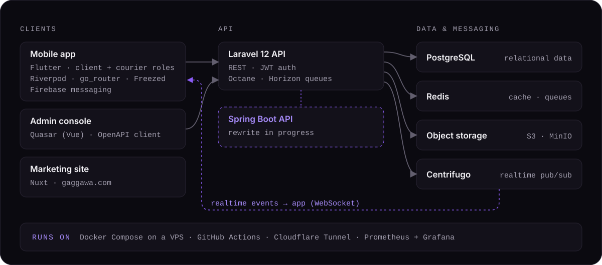

<picture>
  <source media="(prefers-color-scheme: dark)" srcset="https://raw.githubusercontent.com/abdoulbassitalamine/abdoulbassitalamine/main/assets/hero-dark.svg">
  <source media="(prefers-color-scheme: light)" srcset="https://raw.githubusercontent.com/abdoulbassitalamine/abdoulbassitalamine/main/assets/hero-light.svg">
  
</picture>

  

  <a href="https://www.linkedin.com/in/abdoul-bassit-laminou-amadou/"><b>LinkedIn</b></a>
  &nbsp;·&nbsp;
  <a href="#gaggawa"><b>Gaggawa</b></a>
  &nbsp;·&nbsp;
  <a href="#stack"><b>Stack</b></a>
  &nbsp;·&nbsp;
  Île-de-France, open to software engineering roles

## About

I'm a software engineer who builds mobile products and the systems behind them. Since 2024 I have worked on production Flutter apps across three teams: maintaining and rewriting codebases, shipping features and App Store / Google Play releases, reviewing code, and shaping Clean Architecture projects with Riverpod.

Outside client work I build [Gaggawa](#gaggawa) end to end — mobile app, API, admin console and the infrastructure it runs on. That is where my interest moved toward the backend: data modelling, queues, realtime messaging, deployment and observability. I'm now deepening that direction with Java and Spring Boot.

Master's in Software Engineering &amp; Application Integration — ISIMA · State engineering degree in Telecommunications &amp; Networks — ENSA Safi

## Experience

**Niji** — Flutter Developer · Apr 2026 – Sep 2026 
Production app for internship tracking (activity declarations, tutor validation, skills follow-up): new features including push notifications, bug fixes, refactoring and code reviews. Extended an internal devtool with notification debugging, embedded-database and Socket.IO modules.

**Mamaalink** — Flutter Developer · Oct 2025 – Mar 2026 
Maintained a production Flutter app, shipped features and Android / iOS releases, contributed to its Clean Architecture + Riverpod design with unit tests, organised the code as a Melos monorepo, and helped a developer ramp up on the project.

**Manaos Consulting** — Flutter Developer, technical referent · Oct 2024 – Sep 2025 
Mobile app for cybersecurity analysts (client: Orange Cyberdefense). Rewrote the app from the ground up, carried the mobile app on my own after an initial phase as a pair, handled store releases and fixed issues found in vulnerability scans. Also built Laravel REST endpoints and Vue.js screens.

## Stack

| Area | Tools | Where it comes from |
| :--- | :--- | :--- |
| **Mobile** |  Riverpod · BLoC · go_router · Freezed · Melos · Clean Architecture · unit tests | Professional, daily since 2024 |
| **Backend** |  REST APIs · JWT auth · queues · realtime (Centrifugo) · OpenAPI | Laravel: professional and Gaggawa · Java / Spring Boot: personal projects, actively learning |
| **Data** |  SQL · schema migrations · S3 object storage | Gaggawa |
| **Infra &amp; ops** |  Docker Compose · VPS deployment · CI/CD · monitoring and alerting | Gaggawa (self-hosted) |
| **Web** |  Vue.js · Quasar · Nuxt | Vue.js: professional · Quasar, Nuxt: Gaggawa |

## Selected work

### Gaggawa

**Local package delivery for Niamey, Niger — in development, pre-launch.**
A client enters a request once (pickup, destination, contacts, package), a verified courier accepts it, and its status stays visible until hand-off — instead of a string of phone calls. One Flutter app serves both clients and couriers. I design and build every part of it.

<picture>
  <source media="(prefers-color-scheme: dark)" srcset="https://raw.githubusercontent.com/abdoulbassitalamine/abdoulbassitalamine/main/assets/gaggawa-architecture-dark.svg">
  <source media="(prefers-color-scheme: light)" srcset="https://raw.githubusercontent.com/abdoulbassitalamine/abdoulbassitalamine/main/assets/gaggawa-architecture-light.svg">
  
</picture>

- **Mobile** — feature-first modules split into domain / data / presentation, Riverpod with code generation, `Result<T>` error handling, an API client generated from OpenAPI, realtime updates over Centrifugo.
- **API** — Laravel 12 with JWT auth, delivery statuses and roles, Horizon-managed queues, identity documents behind short-lived signed URLs. A Spring Boot rewrite is underway; the Laravel API is the current implementation.
- **Operations** — images built in GitHub Actions and published to GHCR, deployed with Docker Compose behind Nginx and a Cloudflare Tunnel, monitored with Prometheus, Grafana and Alertmanager.

[gaggawa.com](https://www.gaggawa.com) · source code private

### Earlier work

- [**clinica**](https://github.com/abdoulbassitalamine/clinica) — patient management app for a clinic, my bachelor's final project. Flutter, Firebase Auth, Cloud Firestore.
- [**stock_management**](https://github.com/abdoulbassitalamine/stock_management) — stock management between suppliers and customers, a team school project. Flutter, Firebase.

## Activity

Most of my current work lives in private repositories, so public repository and language statistics under-represent it. The card below counts my contributions on GitHub, including private ones whenever they are shown on my profile.

  <picture>
    <source media="(prefers-color-scheme: dark)" srcset="https://streak-stats.demolab.com/?user=abdoulbassitalamine&background=0B0A10&border=272331&stroke=272331&ring=8B5CF6&fire=A78BFA&currStreakNum=F4F3F7&sideNums=F4F3F7&currStreakLabel=A78BFA&sideLabels=A29EAE&dates=625E6E&border_radius=16&card_width=600">
    <source media="(prefers-color-scheme: light)" srcset="https://streak-stats.demolab.com/?user=abdoulbassitalamine&background=FBFAFD&border=E4E0EC&stroke=E4E0EC&ring=7C3AED&fire=7C3AED&currStreakNum=14121A&sideNums=14121A&currStreakLabel=6D28D9&sideLabels=55515F&dates=8F8A9C&border_radius=16&card_width=600">
    
  </picture>

## Contact

The quickest way to reach me is [LinkedIn](https://www.linkedin.com/in/abdoul-bassit-laminou-amadou/). I'm open to software engineering roles in France — mobile, backend, or both.

<picture>
  <source media="(prefers-color-scheme: dark)" srcset="https://raw.githubusercontent.com/abdoulbassitalamine/abdoulbassitalamine/main/assets/footer-dark.svg">
  <source media="(prefers-color-scheme: light)" srcset="https://raw.githubusercontent.com/abdoulbassitalamine/abdoulbassitalamine/main/assets/footer-light.svg">
  
</picture>
